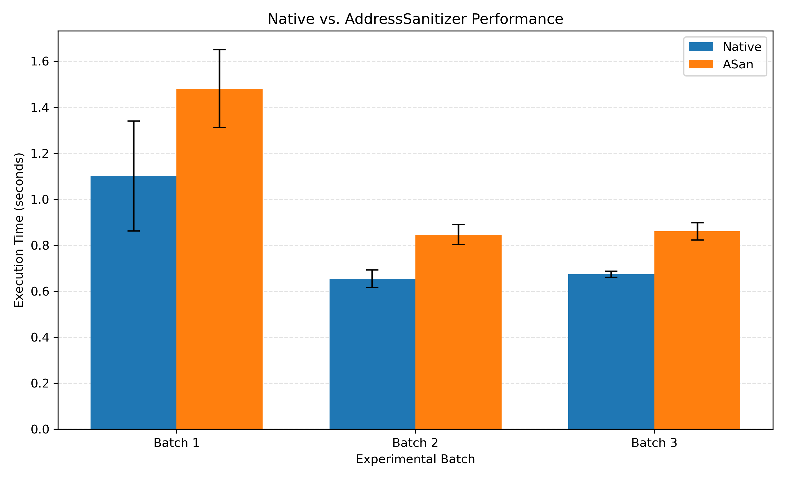

# CS340 Research Paper Replication

## 1. Project Information

**Course:** CS340 Operating Systems (2026–2027)

**Paper:** AddressSanitizer: A Fast Address Sanity Checker

**Authors:** Konstantin Serebryany, Derek Bruening, Alexander Potapenko, and Dmitry Vyukov

**Conference:** USENIX ATC 2012

**Paper Link:** https://www.usenix.org/system/files/conference/atc12/atc12-final39.pdf

## 2. Project Objective

The objective of this project is to reproduce selected experiments from the AddressSanitizer research paper.

AddressSanitizer (ASan) is a memory error detection tool for C and C++ programs. It can detect errors such as buffer overflows and use-after-free.

Our replication will investigate the performance overhead and memory usage of programs compiled with AddressSanitizer.

## 3. Planned Reproduction Experiments

### Experiment 1: Memory Error Detection

- Prepare small C/C++ programs containing memory errors.
- Compile the programs with and without AddressSanitizer.
- Run the programs and collect AddressSanitizer error reports.
- Compare the detected errors with the expected behavior.

### Experiment 2: Execution Time Overhead

- Select reproducible benchmark programs.
- Compile each benchmark with and without AddressSanitizer.
- Execute each configuration at least three times.
- Calculate the mean execution time and standard deviation.
- Calculate the slowdown introduced by AddressSanitizer.
- Compare the results with the original paper, noting any differences in workloads and hardware.

### Experiment 3: Memory Usage Overhead

- Measure the peak memory usage of benchmark programs with and without AddressSanitizer.
- Repeat measurements at least three times.
- Compare the results and investigate any differences from the original paper.

## 4. Reproduction Methodology

We will document:

- Hardware and operating system information.
- Compiler and tool versions.
- Benchmark programs and input workloads.
- Build and execution commands.
- Differences between our environment and the original paper.
- Raw experiment logs and processed results.

## 5. Planned Extension

We plan to investigate how different workload sizes influence the performance overhead of AddressSanitizer while keeping other experimental conditions unchanged.

## 6. Project Status

- [x] Research paper assigned.
- [x] GitHub repository created.
- [x] Experimental environment configured.
- [x] Memory error detection experiments completed.
- [x] Performance experiments completed (runtime: `results/performance/`; memory overhead for Claim 2 in progress).
- [ ] Results analyzed and visualized.
- [ ] Extension experiment completed.
- [ ] Final report and presentation completed.

## 7. References

1. Serebryany, K., Bruening, D., Potapenko, A., and Vyukov, D. (2012). *AddressSanitizer: A Fast Address Sanity Checker*. USENIX Annual Technical Conference.
2. LLVM AddressSanitizer Documentation: https://clang.llvm.org/docs/AddressSanitizer.html

## 8. Week 2: Performance Overhead Experiment

### Objective
Measure the execution-time overhead introduced by AddressSanitizer using a custom array-update benchmark.

### Environment
- CPU: AMD Ryzen 7 8845H
- OS: Ubuntu on WSL2
- Kernel: 6.18.54.1-microsoft-standard-WSL2
- Compiler: Clang 21.1.8
- WSL-visible memory: 7.4 GiB

### Benchmark Configuration
- Array size: 64 MiB (16,777,216 integers)
- Update passes: 200
- Compilation optimization: -O2
- Timing method: CLOCK_MONOTONIC
- Two versions: Native and ASan

### Experimental Procedure
Three batches were conducted, each containing five Native runs and five ASan runs. The execution order was alternated between the two versions. All 30 executions produced identical checksums.

### Results

| Batch | Native Mean (s) | Native SD (s) | ASan Mean (s) | ASan SD (s) | Overhead |
|---|---:|---:|---:|---:|---:|
| 1 | 1.100852 | 0.238787 | 1.480847 | 0.168804 | 34.52% |
| 2 | 0.654080 | 0.037825 | 0.845528 | 0.043863 | 29.27% |
| 3 | 0.673869 | 0.013495 | 0.859979 | 0.037713 | 27.62% |

**Performance Comparison**

Error bars represent ±1 sample standard deviation (n = 5 per version per batch).

Across all 15 runs per version, the overall execution-time overhead was 31.19%.

### Limitations
Batch 1 exhibited greater timing variability than Batches 2 and 3. The source of this variation has not been established. The overall result includes between-batch variation.

Our benchmark differs from the SPEC CPU2006 workloads used in the original paper. Therefore, this experiment provides a reduced-scale performance investigation rather than a direct reproduction of the paper's 73% average overhead.

### Reproduction Files
- Source: experiments/performance/array_update_benchmark.c
- Execution scripts: experiments/performance/run_benchmark.sh and run_benchmark_batch2.sh and run_benchmark_batch3.sh
- Analysis script: experiments/performance/analyze_benchmarks.py
- Logs: results/performance/benchmark_runs_batch1.log, benchmark_runs_batch2.log, benchmark_runs_batch3.log
- Data: results/performance/benchmark_summary.csv
- Statistics: results/performance/performance_analysis.txt
