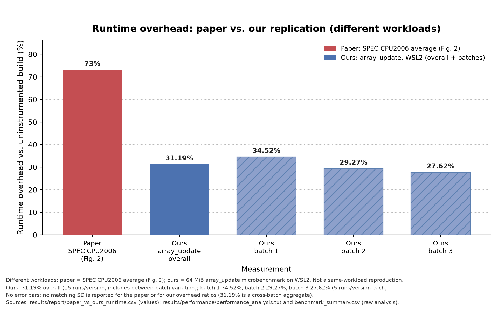

# Paper vs. Ours

This page is the report-facing comparison between the numbers published in
*AddressSanitizer: A Fast Address Sanity Checker* (Serebryany et al., USENIX ATC
2012) and the numbers our group measured. Its main point is **comparability**:
which quantities are close enough to be discussed together, which are not, and
why. It is not a claim that either paper figure was reproduced.

The runtime values come from
[`results/report/paper_vs_ours_runtime.csv`](../results/report/paper_vs_ours_runtime.csv);
the figure is generated from that CSV by
[`scripts/plot_paper_vs_ours.py`](../scripts/plot_paper_vs_ours.py). Memory values
come from [`results/memory_claim2/`](../results/memory_claim2/). The complete
figure index, including owners and pending items, is
[`docs/FIGURE_INVENTORY.md`](FIGURE_INVENTORY.md).



*Figure 1. Runtime overhead, paper (SPEC CPU2006 average, Fig. 2) against our
`array_update` microbenchmark (overall and per batch). The bars are placed side by
side for scale only: the workloads differ, so the two collections are not a
like-for-like replication. No error bars are drawn; see "Uncertainty" below.*

## 1. Runtime overhead (Claim 1)

| | Paper | Ours | Directly comparable? |
|---|---|---|---|
| Metric | Average runtime slowdown on SPEC CPU2006 (Fig. 2) | Execution-time overhead of the instrumented build over the native build | — |
| Workload | SPEC CPU2006, 64-bit Linux | `array_update`: 64 MiB array, 200 update passes | **No** |
| Value | **73%** average | **31.19%** overall; batches **34.52%, 29.27%, 27.62%** | **No** |
| Sample | Repetition count and SD for the average are not stated in the paper | 30 runs: 3 batches × 5 runs per version | — |

Batch detail (mean ± 1 sample SD of wall time, n = 5 per version per batch):

| Batch | Native mean (s) | Native SD (s) | ASan mean (s) | ASan SD (s) | Overhead |
|---|---:|---:|---:|---:|---:|
| 1 | 1.100852 | 0.238787 | 1.480847 | 0.168804 | 34.52% |
| 2 | 0.654080 | 0.037825 | 0.845528 | 0.043863 | 29.27% |
| 3 | 0.673869 | 0.013495 | 0.859979 | 0.037713 | 27.62% |
| All 15 runs per version | 0.809600 | 0.249530 | 1.062118 | 0.321035 | **31.19%** |

Source of every value above:
[`results/performance/performance_analysis.txt`](../results/performance/performance_analysis.txt)
and its 30 raw rows in
[`results/performance/benchmark_summary.csv`](../results/performance/benchmark_summary.csv)
(original runner logs: `results/performance/benchmark_runs_batch1.log` … `batch3.log`).

### Uncertainty

The paper does not report a standard deviation that matches our measurement, so
Figure 1 draws **no paper error bar**, and none is invented. On our side,
`performance_analysis.txt` reports the mean and sample SD of **wall time**, not of
the overhead ratio. The overall means are 0.809600 s (SD 0.249530 s) native and
1.062118 s (SD 0.321035 s) ASan over 15 runs each; 31.19% is computed from those
two means and therefore includes between-batch variation (native CV 30.82%, ASan
CV 30.23%). Batch 1 is the noisiest (native CV 21.69%), batch 3 the tightest
(native CV 2.00%). Because no SD exists for the overhead ratio itself, the figure
has no error bars; the batch-specific values above are the honest way to show the
spread.

### Why 31.19% is not a reproduction of 73%

- **Workload.** SPEC CPU2006 (paper) vs. a custom 64 MiB `array_update`
  microbenchmark (ours). Different memory-access and allocation patterns produce
  different instrumentation overheads even on identical hardware.
- **Hardware.** Paper: HP Z600, 2 × Intel Xeon E5620, 24 GB RAM. Ours: AMD Ryzen 7
  8845H under WSL2, 7.4 GiB visible memory.
- **Compiler.** LLVM circa 2011–2012 vs. Clang 21.1.8; the optimiser's treatment
  of instrumentation changed substantially in the intervening decade.
- **Operating system.** Bare 64-bit Linux (2012) vs. Ubuntu on WSL2, kernel
  6.18.54.1-microsoft-standard-WSL2; virtualisation adds scheduling and timing
  noise.
- **ASan configuration.** We deliberately set the paper's options
  (`redzone=32`, `quarantine_size_mb=0`, `malloc_context_size=0`,
  `detect_leaks=0`), but the runtime is a modern implementation with different
  defaults and code generation.

The correct statement is: *on a different, smaller workload in a modern WSL2
environment, we measured 31.19% overall runtime overhead, well below the paper's
73% SPEC CPU2006 average. This is a reduced-scale investigation, not a numerical
reproduction of Figure 2.* See also `docs/DEVIATIONS.md` rows 1–9 and 16.

## 2. Memory overhead (Claim 2)

| | Paper (Table 1) | Ours (Claim 2) | Directly comparable? |
|---|---|---|---|
| Metric | **VmPeak** (virtual address-space high-water mark) | **VmHWM** (peak resident set) | **No — different metric** |
| Workload | SPEC CPU2006 | b1–b4 microbenchmarks, scale 1 | **No — different workload** |
| Value | **3.37x** average | **1.41x** unweighted mean; second session **1.40x** | **No** |

Per benchmark (primary session `20261121T051205Z`, n = 3 per configuration):
b1 2.05x, b2 1.18x, b3 1.25x, b4 1.16x; unweighted mean 1.41x (sample SD 0.43
across the four benchmarks). The independent second session
(`20261121T051259Z`) gives 2.02x / 1.18x / 1.26x / 1.16x, mean 1.40x, so every
benchmark reproduces within 0.03x.

**Why VmPeak is not used.** Every ASan run in this environment reports
`VmPeak` ≈ 21 474 900 000 kB (about 20 TiB) because the runtime reserves its shadow
address space at start-up. Within a benchmark the value is identical across the
three runs (sample SD = 0); across the four benchmarks it varies by only
147 480 kB (< 0.001% of 20 TiB). A ratio built on that number (1.8×10⁵–1.4×10⁶x)
measures the reservation, not the program, so it is reported only in Table B of
the Claim 2 summary for transparency. `VmHWM` cannot be inflated by a
`PROT_NONE` reservation and is the closest available proxy.

**What must not be claimed.** 1.41x (VmHWM, four microbenchmarks) is **not** a
reproduction of 3.37x (VmPeak, SPEC CPU2006), and the two numbers must never be
placed in the same column as if they were the same metric. They are reported side
by side only to state the deviation. See
[`results/memory_claim2/README.md`](../results/memory_claim2/README.md),
[`summary.md`](../results/memory_claim2/20261121T051205Z/summary.md), and
`docs/CLAIMS.md` (Claim 2) and `docs/DEVIATIONS.md` rows 17–20.

## 3. Detection (Claim 3)

Claim 3 is qualitative, so there is no Paper-vs-Ours
numerical ratio to plot.

| Test case | Plain exit | ASan exit | ASan reported class | Match |
|---|---:|---:|---|---|
| Heap buffer overflow | 0 | 1 | heap-buffer-overflow | Yes |
| Stack buffer overflow | 0 | 1 | stack-buffer-overflow | Yes |
| Global buffer overflow | 0 | 1 | global-buffer-overflow | Yes |
| Heap use-after-free | 0 | 1 | heap-use-after-free | Yes |

All four intentionally constructed error cases were correctly
detected and classified by ASan.

The clean-control experiment used four benchmarks (b1-b4),
two configurations (Base and ASan), and three repetitions
per configuration.

| Benchmark | Base successful | ASan successful | Observed ASan false positives |
|---|---:|---:|---:|
| b1_malloc_text | 3/3 | 3/3 | 0/3 |
| b2_pointer_chase | 3/3 | 3/3 | 0/3 |
| b3_matmul | 3/3 | 3/3 | 0/3 |
| b4_string_scan | 3/3 | 3/3 | 0/3 |
| Total | 12/12 | 12/12 | 0/12 |

All 24 clean-control executions exited successfully.
No ASan reports were observed in the 12 ASan-enabled runs.

**Verdict: supported for the tested cases.**

The results support the paper's qualitative detection claim
within the tested scope. They do not establish universal
detection completeness or the absence of false positives
in arbitrary programs. The paper's Chromium bug-finding
experiment was not reproduced.

Evidence:

- [`results/detect/summary.md`](../results/detect/summary.md)
- [`results/detect/false_positive/summary.csv`](../results/detect/false_positive/summary.csv)

See [`docs/FIGURE_INVENTORY.md`](FIGURE_INVENTORY.md) for the
report matrix presentation status.

## 4. Workload scaling extension

The Week 3 extension measures b1–b4 at scales 1, 2 and 3
([`results/week3_scaling/analysis/summary.md`](../results/week3_scaling/analysis/summary.md)).
It reports unweighted average slowdowns of 193.8%, 177.2% and 184.7% and VmHWM
ratios of 1.402x, 1.320x and 1.360x. These are **not** SPEC CPU2006 numbers and do
not reproduce 73% or 3.37x; the scaling figures are catalogued as Figures 4–8 in
[`docs/FIGURE_INVENTORY.md`](FIGURE_INVENTORY.md). The VmPeak scaling figure must
be read as a virtual-address-space reservation (~20 TiB), never as physical RAM.

## 5. What the report must not claim

- That 31.19% reproduces, or is directly comparable with, the paper's 73%.
- That 1.41x reproduces the paper's 3.37x; the metric and the workload both differ.
- That VmPeak (≈20 TiB) is physical memory use, or that VmPeak and VmHWM can be
  used interchangeably.
- Any standard deviation for the paper's 73%, or an error bar on Figure 1 invented
  to fill the gap.
- That ASan never produces false positives or detects every memory error.
  Our evidence is limited to four positive cases and 12 ASan-enabled
  clean-control executions.

## 6. Regenerate Figure 1

```sh
python3 scripts/plot_paper_vs_ours.py
# reads  results/report/paper_vs_ours_runtime.csv
# writes results/figures/paper_vs_ours_runtime.png
```

The script validates the CSV (required columns, exactly one row carrying the paper
value together with the overall comparison, at least one batch, a source file and
a comparability note on every row) and draws one bar per row plus the paper
reference bar. It contains no result value of its own; editing the CSV and
rerunning is the only way to change the figure. matplotlib is required.

## 7. Source chain

| File | What it provides | Used for |
|---|---|---|
| [`results/report/paper_vs_ours_runtime.csv`](../results/report/paper_vs_ours_runtime.csv) | Report-level rows: one paired 73% vs. 31.19% comparison row plus the three batch rows, each with source and comparability note | Input of Figure 1; T1 in the inventory |
| [`results/performance/performance_analysis.txt`](../results/performance/performance_analysis.txt) | Batch and overall means, sample SD, CV, overhead | Values in the batch table |
| [`results/performance/benchmark_summary.csv`](../results/performance/benchmark_summary.csv) | 30 raw elapsed-time rows | Traceability of every mean |
| [`results/performance/benchmark_runs_batch1.log`](../results/performance/benchmark_runs_batch1.log) … `batch3.log` | Original runner output | Raw records behind the CSV |
| [`results/memory_claim2/20261121T051205Z/summary.md`](../results/memory_claim2/20261121T051205Z/summary.md) | Claim 2 Table A/B and per-run VmHWM values | Memory comparison |
| [`docs/CLAIMS.md`](CLAIMS.md), [`docs/DEVIATIONS.md`](DEVIATIONS.md) | Claim wording, verdicts, quantified deviations | Report text |
| [`docs/FIGURE_INVENTORY.md`](FIGURE_INVENTORY.md) | All figures/tables, owners, pending status | Report assembly |
| [`results/detect/summary.md`](../results/detect/summary.md) | Four positive detection cases and clean-control overview | Claim 3 detection results |
| [`results/detect/false_positive/summary.csv`](../results/detect/false_positive/summary.csv) | 24 clean-control execution records | Claim 3 false-positive check |

## Week 4 extension: cross-environment VmHWM consistency

The Scale 1 workload-scaling results and the two Claim 2
memory sessions were compared across two hardware and
compiler environments.

The unweighted mean VmHWM ratios over the four benchmarks
were:

- AMD / Clang 21.1.8: 1.4016x.
- Intel / Clang 18.1.3, session 1: 1.4126x.
- Intel / Clang 18.1.3, session 2: 1.4042x.

The analysis contains 12 benchmark-session ratios derived
from 72 historical measured executions. Sessions are not
pooled.

The allocation-intensive b1 benchmark consistently has the
highest resident-memory ratio in these sessions.

These observations provide limited descriptive evidence
of cross-environment consistency and workload dependence,
not formal statistical equivalence or a universal memory
overhead estimate.

**Claim 2 verdict remains inconclusive** as a direct
replication of the paper's reported 3.37x VmPeak result:
our measurements use VmHWM and different benchmarks.

Evidence and reproduction instructions:

- [Cross-environment analysis](../results/cross_environment/README.md)
- [Comparison CSV](../results/cross_environment/comparison.csv)
- [Figure 9](../results/cross_environment/figures/vmhwm_cross_environment.png)
- [Analysis script](../results/cross_environment/plot_comparison.py)


## Reporting conventions

Final report terminology, aggregation, uncertainty and claim interpretation follow [Statistical and Reporting Conventions](STATISTICAL_CONVENTIONS.md).
