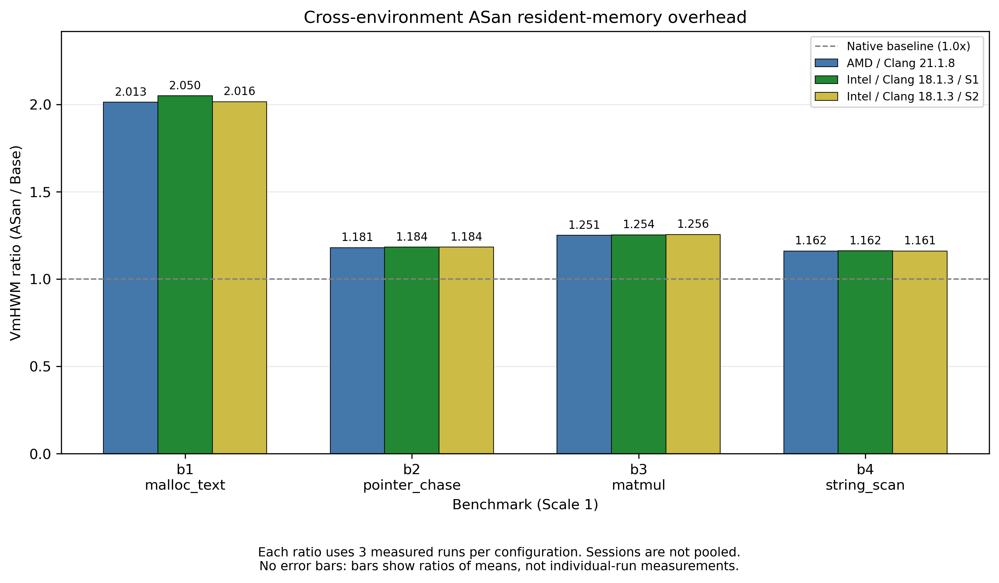

# Cross-Environment Resident-Memory Overhead Analysis

## 1. Research Question

How consistent is AddressSanitizer's resident-memory overhead
across different hardware and compiler environments when
executing the same custom microbenchmark suite?

This extension complements Claim 2 and the Week 3 workload
scaling study in our partial replication of AddressSanitizer
(Serebryany et al., USENIX ATC 2012).

## 2. Experimental Environments

| Factor | Environment A | Environment B |
|---|---|---|
| Experiment owner | Ren Yi'an (1240014055) | Ye Jingwei (1240004926) |
| CPU | AMD Ryzen 7 8845H | Intel Core i5-14600KF |
| Compiler | Clang 21.1.8 | Clang 18.1.3 |
| Operating environment | Ubuntu / WSL2 | Ubuntu 24.04 / WSL2 |
| Session count | 1 | 2 |
| Session date | 2026-11-17 | 2026-11-21 |
| Workload scale | 1 | 1 |
| Optimization | -O2 | -O2 |
| Measured repetitions | 3 per configuration | 3 per configuration |
| Warm-up | 1 per configuration | 1 per configuration |
| Memory metric | VmHWM | VmHWM |

The reported performance configuration is:

    ASAN_OPTIONS=quarantine_size_mb=0:malloc_context_size=0:detect_leaks=0:redzone=32

The committed benchmark, Makefile and experiment harness
versions were compared and no differences were found in
the inspected paths.

This source comparison does not establish that every local
execution used an identical working tree.

## 3. Methodology

The analysis includes four microbenchmarks:

- b1_malloc_text: frequent heap allocations and deallocations.
- b2_pointer_chase: dependent random memory accesses.
- b3_matmul: dense floating-point matrix multiplication.
- b4_string_scan: repeated byte-wise text scanning.

Only Scale 1 measurements are included.

For each benchmark and session:

    VmHWM ratio = mean(ASan VmHWM) / mean(Base VmHWM)

The session-level mean is the unweighted arithmetic mean
of the four benchmark ratios.

Each ratio is based on three measured Base executions and
three measured ASan executions. Warm-up executions are excluded.

There are two experimental environments, three sessions,
12 benchmark-session ratios and 72 historical measured
executions. The sessions are kept separate and are not pooled.

## 4. Data Sources and Validation

The analysis uses the following committed sources:

- [Environment A aggregate CSV](../week3_scaling/combined/combined_results.csv)
- [Environment A raw log](../week3_scaling/scale1/20261117T093819Z/runs.log)
- [Environment B session 1 CSV](../memory_claim2/20261121T051205Z/results.csv)
- [Environment B session 1 raw log](../memory_claim2/20261121T051205Z/runs.log)
- [Environment B session 2 CSV](../memory_claim2/20261121T051259Z/results.csv)
- [Environment B session 2 raw log](../memory_claim2/20261121T051259Z/runs.log)

The analysis script verifies run identifiers, exit codes,
measurement units, sample counts, means and sample standard
deviations against the original logs.

Historical experiment records are not modified.

## 5. Results

| Benchmark | AMD / Clang 21 | Intel S1 | Intel S2 | Spread |
|---|---:|---:|---:|---:|
| b1_malloc_text | 2.0132x | 2.0503x | 2.0160x | 0.0372x |
| b2_pointer_chase | 1.1807x | 1.1841x | 1.1837x | 0.0034x |
| b3_matmul | 1.2510x | 1.2541x | 1.2557x | 0.0047x |
| b4_string_scan | 1.1615x | 1.1617x | 1.1614x | 0.0003x |
| **Unweighted mean** | **1.4016x** | **1.4126x** | **1.4042x** | 0.0110x |

Spread is defined as the maximum ratio minus the minimum
ratio across the three sessions. It is descriptive and
is not a standard deviation or confidence interval.

The largest observed benchmark-level spread is
0.0372x, for b1_malloc_text.

The spread between session-level unweighted means is
0.0110x.

Figure: ratios of mean VmHWM values, with three measured
executions per configuration. The dashed line represents
the native baseline of 1.0x. Error bars are not shown because
the reported bars are ratios of means.

Full numerical results: [comparison.csv](comparison.csv).

## 6. Analysis

### 6.1 Cross-environment consistency

Across the tested environments, session-level unweighted
mean VmHWM ratios range from 1.4016x
to 1.4126x.

The observed ratios are similar across these sessions,
despite differences in CPU and compiler versions.

This provides descriptive evidence of cross-environment
consistency for the selected benchmarks.

### 6.2 Workload dependence

The allocation-intensive b1_malloc_text benchmark has
the highest VmHWM ratio in all three sessions.

The consistency of this pattern supports the observation
that ASan resident-memory overhead depends on workload
characteristics.

However, the experiment does not isolate individual causal
mechanisms responsible for the observed differences.

### 6.3 Within-environment repeatability

The two Intel sessions provide evidence of repeatability
under the same recorded hardware and software environment.

They are separate sessions on one environment, not two
additional independent machines.

### 6.4 Relationship to the original paper

The original paper reports an average memory ratio of
3.37x using VmPeak on SPEC CPU2006 (Table 1).

Our analysis instead uses VmHWM on four custom benchmarks.

VmPeak measures virtual address-space usage, whereas
VmHWM measures peak resident memory. Modern ASan reserves
a large virtual address range for shadow memory.

Consequently, this extension neither reproduces nor
contradicts the paper's numerical 3.37x result.

## 7. Limitations

- Only two hardware environments were evaluated.
- Both environments use WSL2.
- Only four custom benchmarks at Scale 1 were included.
- Each configuration contains three measured repetitions.
- Hardware, compiler and other environmental factors
  are not independently controlled.
- Periodic /proc sampling may miss the final memory peak.
- Ratios can conceal differences in absolute memory usage.
- The analysis is descriptive; no statistical equivalence
  or significance has been established.
- Historical source commits do not prove identical local
  working trees at execution time.
- The benchmarks and memory metric differ from those
  used in the original paper.

## 8. Conclusion

Within the tested configurations, ASan exhibits similar
resident-memory overhead patterns across two environments
and three experimental sessions.

The allocation-intensive benchmark consistently produces
the highest resident-memory ratio.

These results support limited cross-environment consistency
and workload dependence of ASan resident-memory overhead.

They do not establish a universal memory overhead ratio
or a direct numerical reproduction of the original paper.

Claim 2 remains inconclusive as a direct replication of
the paper's VmPeak result.

## 9. Reproduction

From the repository root, with Python, matplotlib and NumPy:

    python3 results/cross_environment/plot_comparison.py

The script validates the historical data and regenerates:

- comparison.csv
- figures/vmhwm_cross_environment.png

No new benchmark executions are required.

## 10. Contributions

- Ren Yi'an: Environment A experiments, cross-environment
  analysis, data validation, visualization and integration.
- Ye Jingwei: Environment B experiments, memory measurement
  analysis and independent repeated sessions.

## Reference

Serebryany, K., Bruening, D., Potapenko, A., and Vyukov, D.
(2012). AddressSanitizer: A Fast Address Sanity Checker.
USENIX Annual Technical Conference.

https://www.usenix.org/system/files/conference/atc12/atc12-final39.pdf

## Reporting clarification

This analysis reuses 72 measured executions and introduces
no new experimental executions.

The absence of ratio error bars means that uncertainty
of the ratios was not estimated. It does not imply that
the underlying measurements have zero variability.

The comparisons are descriptive. Differences in host,
compiler and environment have not been isolated experimentally.
Matching committed source snapshots does not independently
establish that every historical run used an unmodified worktree.

See [Statistical and Reporting Conventions](../../docs/STATISTICAL_CONVENTIONS.md).
